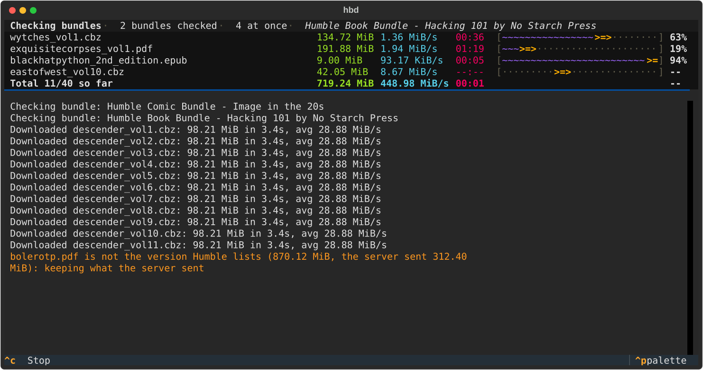

# Humble Bundle Downloader

[](https://pypi.python.org/pypi/humblebundle-downloader)
[](https://pypi.python.org/pypi/humblebundle-downloader)

**Download all of your content from your Humble Bundle Library!**  

The first time this runs it may take a while because it will download everything.
After that it will only download the content that has been updated or is missing.  


## Features

- works with Humble's rebuilt website (2026), which removed the api older versions relied on
- the subscriber vault, which replaced the Trove _(`--vault`, or `--trove` for the vault alone)_
- downloads new and updated content from your Humble Bundle Library on each run _(only check for updates if using `--update`)_
- cli command for easy use (downloading will also work on a headless system)
- works for SSO and 2FA accounts
- downloads several files at once, 4 by default, or `-j auto` to find the fastest number _(`--jobs`/`--no-parallel` flags)_
- a live interface in the terminal: every download in flight, the totals and the log _(automatic; plain log lines when piped, redirected or run from cron)_
- optional dry run that reports how much there is to download before downloading any of it _(`--dry-run` flag)_
- optional listing of the url of every file being collected _(`--print-urls` flag)_
- optional filter by file types using an include _or_ exclude list _(`--include/--exclude` flag)_
- optional filter by platform types like video, ebook, etc... _(`--platform` flag)_
- optional single format per item, with an ordered preference and a largest-file fallback, or just the largest file _(`--prefer-format` flag, `-f largest`)_


## Install


### Using PIP

`pip install humblebundle-downloader`


### Using docker

Remember to mount your download directory in the container using dockers `-v` argument.
`docker run ghcr.io/xtream1101/humblebundle-downloader -h`

Give it `-it` to get the interface; without a terminal it prints plain log lines.


### From a clone, with uv

`uv tool install --editable .` installs `hbd` from the clone, and picks up changes to the code as
you make them. Run it again with `--force` after a change to the dependencies.


## Instructions


### 1. Getting cookies

First thing to do is get your account cookies.
This can be done by getting a browser extension that lets you see or export your cookies.

- **Method 1 (recommended)**
    - Sign in at humblebundle.com, open your browser's developer tools, go to the **Network** tab and
      reload your library page. Click the request for `library`, find the `Cookie` request header, and
      copy its whole value. Pass it using `-s 'COOKIE HEADER'`, single quotes included.
    - This works whatever the session cookie is called. Since the 2026 rebuild Humble signs you in on
      `auth.humblebundle.com`, so the cookie older instructions named may not be the one that matters.
    - A bare `_simpleauth_sess` value is still accepted, as before: anything that is not
      `name=value` is taken to be one. Some suggestions for common issues can be found in
      [issue #50](https://github.com/xtream1101/humblebundle-downloader/issues/50)

- **Method 2**
    - Export the cookies in the Netscape format using an extension.  
      If your exported cookie file is not working, it may be a formatting issue.
      This can be fixed by running the command `curl -b cookies.orig.txt --cookie-jar cookies.txt http://bogus`


### 2. Downloading your library

Use the following command to download your Humble Bundle Library:  
`hbd --cookie-file cookies.txt --library-path "Downloaded Library"`  
_If using the docker image, exclude the `hbd` part of the command_

This directory structure will be used:  
`Downloaded Library/Purchase Name/Item Name/downloaded_file.ext`

A run that finished but could not download some files lists them at the end, with why, and exits
`1`, so scripts and scheduled jobs can tell it from a clean run, which exits `0`.

If a run stops with a message about signing in, the cookie has expired: sign in again in your
browser and pass the new one. That is reported as an error rather than as an empty library.

The library path is checked before anything else happens. If it does not exist it is created; if it
cannot be created or written to, the run stops right there with one line saying why, rather than
reaching the network and then failing once per file hundreds of files later. Paths under
`/Volumes`, `/media`, `/mnt` and `/run/media` get a reminder to check the drive is mounted, since
that is usually what has gone wrong.

That check is repeated cheaply as the run goes: if the library folder disappears mid-run, which on
an external or network drive means it was unmounted, the run stops instead of quietly rebuilding
the folder tree inside the empty mountpoint and filling your boot disk.


### 3. Checking the size before downloading

Add `--dry-run` (or `-n`) to see what a run would fetch without fetching any of it:  
`hbd --cookie-file cookies.txt --library-path "Downloaded Library" --dry-run`

Nothing is written to disk, no directories are created and the `.cache.json` file is left alone.
Each pending file is listed with its size, followed by a per-bundle breakdown and a grand total:

```
============================================================
Dry run: nothing was downloaded
============================================================
  3.40 GiB     2 file(s)  Game Bundle
 15.00 MiB     2 file(s)  Book Bundle - Sci-Fi
------------------------------------------------------------
4 file(s) to download, 3.41 GiB (3,663,212,288 bytes)
```

The estimate honours every other flag, so `-n` combined with `--include`, `--platform`, `--keys`
or `--update` tells you the size of exactly that subset.
Sizes come from your library pages, the same ones the website shows, so a dry run asks Humble for
no download urls at all and transfers nothing. For the few files with no size listed, a `HEAD`
request is used instead, and anything that still comes back without a size is counted separately at
the end of the summary.


### 4. Listing the download urls

Add `--print-urls` to print the url of each file being collected, one per line.
The urls go to stdout while all other output goes to stderr, so the list can be piped straight into
another tool:

`hbd --cookie-file cookies.txt --library-path "Downloaded Library" --dry-run --print-urls > urls.txt`

This works during a real download too, in which case it lists each file as it is fetched.
Humble only hands out a download url on request, so with `--dry-run` this asks for one per item,
which takes about half a second each: a whole library takes a while. The urls are signed and stop
working after roughly a day, so a saved list is only good for a short time.


### 5. Parallel downloads

Four files download at once by default. Change the number with `--jobs`/`-j`:

`hbd --cookie-file cookies.txt --library-path "Comics" -j 8`

`-j auto` finds the number for you. It starts at 4 and every 15 seconds measures how fast
everything is downloading in total. While two more at once makes that at least a tenth faster, it
adds two more, up to 16; as soon as a step does not pay, it takes it back and leaves it alone for a
minute before trying again. If Humble starts throttling, it halves at once. It only learns from
moments when every download slot was busy, so a slow stretch reading the library does not count
against it. Each change is logged with its reason, the totals line shows the current number, and
the run ends by saying which number was fastest, which makes a good fixed `-j` for next time.

`--no-parallel` goes back to one file at a time, and overrides `--jobs`, so it still works when
`-j` is baked into a shell alias.

### The interface

Run in a terminal, hbd takes over the screen while it works:



- **The status line** says what the run is doing (reading your library, checking bundles,
  downloading, stopping), how many bundles have been checked, how many downloads run at once, and
  which bundle is being checked.
- **A row per download** gives the file, its size, current speed, time left, a bar in your chosen
  style and the percentage. A file whose size the server does not give gets a muncher pacing back
  and forth instead. Rows stay put, so a finished download leaves its row empty for the next one
  rather than making the others jump about. On a narrow screen the time left goes first, then the
  speed, so the bar and percentage are always there; long names keep their end, which is the part
  that tells `vol11` from `vol12`.
- **The totals** count files rather than bytes, and grow a bar once everything has been queued and
  the number to get through is known.
- **The log** has everything else: each file as it finishes, with its size, time and average speed
  (or how far it got if stopped), warnings in yellow and errors in red. Scroll it with the mouse or
  the keyboard; **End** follows it again.

While it runs:

| Key | Does |
|---|---|
| **p** | Pause every download, and start no new ones; **p** again carries on. Connections can time out while paused, and each picks up where it was when resumed |
| **s** | Skip one download: pick it from the list. It stops for this run, keeps what it has, and the next run carries on from there. It does not count as a failure |
| **+** / **-** | One more, or one fewer, download at once. More workers start when needed; fewer takes effect as downloads finish. Setting it by hand stops `-j auto` changing it. A run with `-j 1`, `--no-parallel` or `--dry-run` downloads one file at a time throughout |
| **Ctrl+C** or **q** | Stop, tidily; again to quit at once. See [Stopping a run](#stopping-a-run) |
| **End** | Follow the log again after scrolling back |

When the run ends the screen is handed back, and the warnings, errors and the summary are printed
in the ordinary terminal so they stay in your scrollback. Anything meant for stdout, like
`--print-urls` and `--print-checksums`, is printed then too.

Each run's whole log is also kept in the library, in `.hbd-logs/`, with times and levels: every
file as it finished, everything skipped and why, every warning. The newest 20 are kept, and the
run ends by saying where its log is. Dry runs keep none, so they never push out a real run's log,
and `--no-log-file` turns it off. Download urls carry a token that works for a day, so their query
strings are taken out of every line logged anywhere; `--print-urls` still prints them whole.

When hbd is not run in a terminal (piped, redirected to a file, or from cron) there is no interface,
just the log as plain lines, with no escape codes to clean up afterwards. `--progress`, which used
to turn the old display on, is still accepted so existing commands and aliases keep working, but it
does nothing.

`--progress-style` picks the bar. Most come in from the left as the file starts and leave on the
right as it completes:
`fish` (the default), `snail`, `cycle`, `train` (into a tunnel), `rocket`, `runner`, `duck`, `car`,
`comet` and `ufo`. A few travel to something at the end and arrive as it completes: `mouse` (to the
cheese, which it then eats), `arrow` (into the target) and `worm` (to the apple). `bars` and `blocks`
just fill. They live in `progress_styles.py`, which is a plain dict with no imports, so adding your
own is a few lines. The only rule is that every frame of a style has to be the same width, or the
bar jitters as it animates. Each style also says what colours its parts are drawn in.


### Stopping a run

**Ctrl+C** (or **q** in the interface) asks for a tidy stop. Transfers check between chunks, so they give up promptly rather
than at the end of whatever multi-gigabyte file they happen to be on. Each partly downloaded file
is kept as `<file>.part`, beside a small `<file>.part.json` noting which version of the file it came
from, and the next run carries on from there rather than starting again. It asks only for the rest
(`Range`), and only if the file has not changed since (`If-Range`); if it has, that file starts
again from the top. Either way the whole file is checked against its checksum at the end. The cache
keeps everything already finished, and the run exits with status `130`.

**Ctrl+C again** quits immediately, whatever state anything is in. Without the interface that is
the operating system's default for a second interrupt rather than anything the downloader does;
with it, the interface hands the terminal back first and then leaves without waiting on anything. The `.part.json` is
written as each transfer starts, so the partial files this leaves can be carried on from too. The
cache is saved every few seconds, so this can lose the last few seconds of it; files it forgets are
complete on disk, and the next run recognises them without downloading them again.

If a transfer is wedged somewhere that cannot be interrupted, the first Ctrl+C waits up to five
minutes for it before leaving anyway, so one press is always enough eventually and two are enough
at once. Transfers that are moving stop at their next chunk, so in practice the wait is that short.
`--exit-timeout SECONDS` changes that wait: `--exit-timeout 0` makes the first press quit straight
away, a longer value gives slow drives and flaky connections more room to finish what they were
doing. A second Ctrl+C ignores it entirely and quits at once however long it was set to.
Either way the exit status is `130`, the usual convention for "stopped by SIGINT" — note that
upstream exited `0` here, so a wrapper script can now tell an interrupted run from a complete one.

A few notes on what parallelism does and does not touch. Each worker gets its own
`requests.Session`, built from the authenticated one, since `requests.Session` is not documented as
thread safe. `.cache.json` is written at most every five seconds and once more when the run ends,
always whole, under one lock so concurrent jobs cannot truncate each other's json. asm.js games
still download their page sequentially, because the list of data files to fetch is read out of that
page. Dry runs stay single threaded, having nothing to download.

If Humble starts refusing connections or throttling you, lower `-j` before assuming anything else
is wrong. The downloader handles throttling on its own, though:

- Connection errors and 5xx responses are retried with exponential backoff at the transport layer.
  `--retries` sets how many times (default 5, `0` to fail on the first error).
- A `429 Too Many Requests` pauses **every** worker, not only the one that was refused, for as long
  as the server's `Retry-After` header asks (30s when it does not say). Retrying per request would
  just mean one worker backing off politely while the rest keep hammering.
- The run ends by telling you how many times it was throttled, so a slow run is not a mystery.

Requests identify themselves as `humblebundle-downloader/<version>` rather than the default
`python-requests`, which tends to be treated more harshly by the machinery in front of a CDN.

Transfers that break partway through are picked back up rather than started again. Content is
written to `<file>.part` and only moved into place once it is whole, so an interrupted download is
never mistaken for a finished one, and a previously downloaded copy is left untouched until the new
one is complete.

Whether a transfer can actually resume is the server's call, not an assumption: the downloader asks
with a `Range` header and believes the reply. `206 Partial Content` means it appends to what it
already has; `200` means the server ignored the request, so the file starts again from nothing and
that is noted once in the log. Either way the file you end up with is correct. Runs of
`--retries` apply here too, so a large file that keeps dropping is retried rather than abandoned on
the first stumble.

The resume also carries `If-Range`, holding the `ETag` or `Last-Modified` of the response the
transfer started from. That asks the server for the rest of **this** file rather than the rest of
whatever is at that url now, and a server that notices the difference answers with the whole of the
new file instead of a slice of it. Without that, a file re-generated upstream mid-transfer would
have its new second half stitched onto the old first half, giving a file of exactly the right
length and entirely the wrong contents.


### 6. Checking what arrived

Humble reports a checksum for most files. Each download is hashed as it streams past, costing no
extra pass over the data, and checked against what was promised. A file that does not match is not
kept: the partial file is discarded and it is downloaded again from scratch rather than resumed,
since resuming would keep the bad bytes. `--retries` governs how many attempts it gets, and a file
that never matches is left out of the library and out of the cache, so the next run tries again.

`sha1` is used when it is offered and `md5` otherwise, and the result is recorded in `.cache.json`
so a later run can tell a file that changed on disk from one that changed upstream. Items the api
gives no checksum for are downloaded and kept exactly as before.

This is the backstop for the resume case above: `If-Range` is what prevents a mismatched splice,
and the checksum is what catches one if a server ignores it. `--no-verify` turns the checking off.

Humble replaces files now and then, a new edition or a better scan, without always updating the
size and checksums it lists for them. Such a file arrives whole, at its new size, and cannot match
the old checksum. So a file that does not match, but arrived complete at a different size from the
listing, is taken to be a newer version rather than damage: it is kept, its own checksum recorded,
and a warning names it, with a count at the end of the run. A file at the listed size that does not
match is damaged, and is retried as above. The same goes for files already on disk from before:
one at a different size from the listing is recognised if the server says that is its size now.
Because sizes come from the listing, `--dry-run` totals can be a little out for replaced files.

Not all of those replacements are improvements. Humble regenerated most of its files in November
2026, and many came out far smaller: in one comic bundle, 45 of 89 PDFs shrank to under three
quarters of their listed size, most to the size of the CBZ of the same book, which suggests the same,
more compressed, page images. The originals are no longer offered, torrents included, so the
downloader protects any you already have:

- a file on disk much bigger than what Humble now sends (the new one under 75% of its size) is kept
  rather than downloaded over, even when it matches nothing in the listing
- `--update` will not put a much smaller new version in place of the file you have; it records the
  new version's date and leaves yours alone

`--accept-smaller` turns both off. Every file affected either way, and every newly downloaded file
that arrived much smaller than its listing, is named at the end of the run and kept in a running
list, `.hbd-smaller-than-listed.tsv` in the library, with both sizes and the date.

`--print-checksums` prints the sha1 Humble lists for every file a run would download, to stdout,
in the format `shasum -c` reads, with paths relative to the library. It works with `--dry-run`:

```
hbd ... --dry-run --print-checksums > SHA1SUMS
cd "<library>" && shasum -c ../SHA1SUMS
```

Files Humble has since replaced will not match their listing, for the reason above.


### Verifying the library

`hbd --library-path "Downloaded Library" --verify` downloads nothing. It hashes every file in the
library and compares it with the checksum the cache recorded when it was downloaded, then lists
anything that changed (a damaged drive, an edit, a file replaced by hand) or that the cache says
should be there and is not. It needs no cookie and makes no requests, so it works offline, and
it exits `1` when it found anything, for scripts.

Downloads record where they went and their checksum from 0.6.0 on, even when Humble lists none.
Files from before that are matched by name instead, and files hbd never downloaded (or found
already on disk, at the right size, the first time it saw them) have no checksum to check and are
counted separately. The full list goes to `.hbd-logs/verify-<date>.tsv` in the library.

### 7. Picking one format per item

Bundles usually ship the same book or comic several times over: `.cbz`, `.epub`, `.pdf` and `.mobi`
of the same thing. `--prefer-format` (or `-f`) keeps one format instead of all of them:

`hbd --cookie-file cookies.txt --library-path "Comics" --prefer-format cbz epub pdf`

The extensions are tried **in order**, so the last one you list acts as the default:

1. every `.cbz` in the item, if it has any
2. otherwise every `.epub`
3. otherwise every `.pdf`
4. otherwise the single largest file, whatever its format

That last step is what stops an item disappearing when it ships in some format you did not think to
list, like `.cbr` or `.djvu`.

`largest` can go in the list too, and stands for the biggest file of whatever is offered:

- `-f largest` always takes the biggest file, whatever its format
- `-f cbz largest` takes the `.cbz` when there is one, otherwise the biggest file
- anything after `largest` is never reached, since it always finds a file

"Biggest" is judged by what the server sends now, not by Humble's listing (see below), so an item
offered in more than one format costs one `HEAD` request per format. Items with only one file to
choose from cost nothing.

Selection happens per item **and per platform**, so a game that ships a Windows and a Linux build
still gets one file for each, rather than one file overall.

When the winning format has more than one file in an item, all of them are kept. A comic split
into `Vol1.cbz` and `Vol2.cbz` comes down as both volumes, not just the larger one — the flag
collapses format variants, never content.

`--prefer-format` composes with the other filters, and `--include`/`--exclude` are applied first, so
`-e cbz -f cbz epub` will never pick a `.cbz` and moves on to `.epub`. Combine it with `--dry-run`
to see exactly which file wins for each item before downloading anything.


## How it reads the rebuilt site

In 2026 Humble rebuilt its website and removed the json api this tool used to read the library
from. The website now gets everything through its own server actions: functions the page calls by
name. This tool calls the same ones, in the same way the page does:

- the whole library is listed a thousand entries at a time, so a large library takes a few requests
- each bundle's page supplies every file in it, with its size and checksums, in one request
- a download url is only asked for when a file is about to be downloaded, never ahead of time.
  They expire, and a large library takes longer to download than they last. A url that is refused
  part way through is simply asked for again

Server actions are addressed by ids that change every time Humble updates the site, so none are
written into this tool. Each run finds them by name in the site's own scripts, and only a change to
those names would break it.

Library entries that are keys for Steam, Epic, GOG and so on are left alone, as they always were.

When none of the preferred formats is offered, or the list says `largest`, the largest file is taken, by what the server sends
now: one `HEAD` request per format settles it, since Humble's listed sizes are from before it
regenerated its files, and can be three times what is sent.

### Upgrading from a version before the rebuild

The rebuilt site identifies bundles by new ids, so none of the entries in an older `.cache.json`
match any more. Rather than download everything again, a file already on disk at the place this run
would save it, and at exactly the size the site lists, is recorded in the cache as downloaded and
left alone. The run reports how many files that applied to. Run with `--dry-run` first to see what
would still be downloaded.

The first `--update` run to reach such a file records the date the server reports for it, without
downloading it, so later updates have something to compare against.

### The subscriber vault

The Trove is gone from the rebuilt site; it became the vault, the games that come with a Humble
Choice membership. `--vault` downloads the vault as well as the rest of the library, into a
`Humble Vault` folder. `--trove` used to mean only the Trove, so it now means only the vault, and old
scripts keep working. Vault files are signed through the vault's own server action, by each game's
machine name, and are otherwise handled like everything else: filters, format preference,
checksums, resuming and the cache all apply.


## Notes

- Inside your library folder a file named `.cache.json` is saved and keeps track of the files that have been downloaded.
  This way running the download command again pointing to the same directory will only download new or updated files.
- Use `--help` with all `hbd` commands to see available options
- Every file a filter passes over is logged, which is useful for working out why something did not
  arrive and a wall of noise on a run that filters most of a library out. `--hide-skipped` turns
  those lines off; they drop to debug rather than disappearing, so `HBD_LOGLEVEL=DEBUG` still shows
  them. Orders that could not be read are reported either way, since that is a problem rather than
  a choice you made
- `--platform` takes the names the site uses for each download: `ebook`, `audio`, `video`,
  `comedy`, `image`, `windows`, `mac`, `linux`, `android`, `ios`, `asmjs`, `unitywasm` and `other`.
  Case does not matter, and several can be given: `-p ebook audio`
- Download select bundles by using the `-k` or `--keys` flag.
  These are the ids at the end of a bundle's page in your library, `/home/library/<id>`. The
  thirteen character purchase keys older versions used do not appear on the rebuilt site.
  A key given more than once is only used once, so nothing is fetched or downloaded twice.


## Development

The project is managed with [uv](https://docs.astral.sh/uv/):

- `uv sync` installs it and its development tools into `.venv`, exactly as `uv.lock` pins them
- `uv run pytest` runs the tests, `uv run ruff check humblebundle_downloader tests` lints
- `uv lock --upgrade` moves the pins forward when you want newer dependencies

No test touches the network: `tests/conftest.py` fails any that tries, so the suite never depends
on Humble being up or on an account being signed in. GitHub Actions runs the lint and the tests on
Linux and macOS, on the oldest and newest Python supported, for every push and pull request.

